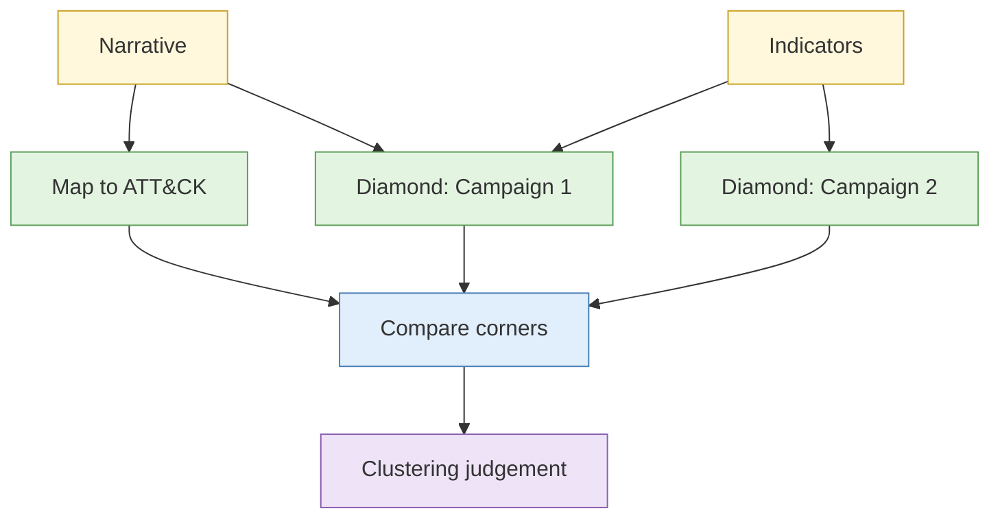

# Lab 4.7 ATT&CK mapping and Diamond Model clustering

| Duration | Type | Running case | Assessed |
| --- | --- | --- | --- |
| 35 minutes | Pairs | Yes: the scenario's campaigns | No |

## Aim

Map observed behaviour to ATT&CK techniques, then cluster the infrastructure with the Diamond Model to test whether two campaigns share an operator.

## Outcome

A **technique mapping** and a **clustering judgement** with a confidence level.

## The analogy: two burglaries, one signature

Two houses are burgled on different streets. The thief entered through a back window in both, took only jewellery, left a muddy print of the same shoe. The police group them. They check if other facts agree or contradict.

## What you need to do

- [ ] Read the intrusion narrative and indicator set
- [ ] Map each observed behaviour to an ATT&CK tactic and technique
- [ ] Fill a Diamond Model for each campaign
- [ ] Compare corners and score the overlap
- [ ] Write the clustering judgement

**Deliverable:** `attack-diamond.md`.

## What the instructor sets up beforehand

- A written intrusion narrative for two fictional campaigns and an indicator set (domains, IPs, hashes, email patterns)
- An offline copy of the ATT&CK technique list
- Planted overlaps and one misleading overlap

## Before you start

- Read [S5 Cyber threat intelligence](../sessions/s5-cyber-threat-intelligence.md).

## Rules for this lab

- Fictional data only.

## How the lab flows

## Steps

1. **Map (10 min):** for each behaviour write tactic, technique and the evidence.
2. **Diamonds (10 min):** fill adversary, capability, infrastructure and victim for each campaign.
3. **Compare (8 min):** list shared items. Mark each as unique, common or unclear.
4. **Judge (7 min):** run a short ACH (Lab 1.2 method) with two hypotheses: same operator or different operators.

## Common mistakes

- Counting common tools as shared operator evidence.
- Naming a real-world group without cause.

## Summary

Clustering is competing hypotheses applied to infrastructure. Unique shared features carry weight; common tools do not.

## Carries forward

- The method is part of the capstone.
