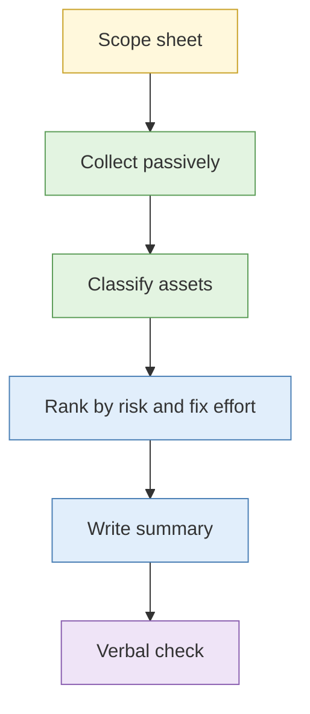

# Lab 4.8 Attack surface map of your own organisation (assessed)

| Duration | Type | Running case | Assessed |
| --- | --- | --- | --- |
| 75 minutes | Individual | No: your organisation (or the fallback sandbox) | **Yes: method assessed in the room** |


**Authorisation first.** Run this lab on your real organisation only if your client scope sign-off covers the assets listed. If sign-off is missing, use the **fallback sandbox organisation**. Passive collection only: no scanning, no logins, no testing of any system.


## Aim

Apply the day's methods to your own organisation's external footprint, and produce an exposure summary suitable for internal escalation.

## Outcome

An **internal exposure summary** you can take back and act on (real-organisation version), or a sandbox summary (fallback version).

## The analogy: walking round your own flat from the outside

You stand in the corridor and look at what a stranger sees: doors, windows, what is left outside, the Christmas lights that show you are away. It is your flat, but you are looking as a burglar would, in order to fix what you see.

## What you need to do

- [ ] Confirm the scope sheet and your authorisation
- [ ] Collect: registration, DNS, certificates, scan-data entries, public documents, cloud references
- [ ] Classify each asset by function and exposure
- [ ] Rank the findings by risk and ease of fix
- [ ] Write the summary: bottom line first, then findings, then actions
- [ ] Present a 3-minute verbal check to the instructors

**Deliverable:** `exposure-summary.md`.

## What the instructor sets up beforehand

- Signed scope sheets from each client organisation, held by the instructors, listing the domains and assets in scope
- The **fallback sandbox organisation** for any delegate without sign-off
- Rubric printed
- Confirmation that exposure summaries will not leave the delegate's machine

## Before you start

- Read Day 4 sessions S1 to S5 and [Lab 4.2](lab-4-2-asset-discovery.md) and [Lab 4.6](lab-4-6-cloud-footprint.md).

## Rules for this lab

- Stay inside the scope sheet.
- Passive sources only.
- If you find something that looks exposed, record the URL and escalate. Do not open it.
- Do not copy personal data. Describe it.

## Marking rubric

| Criterion | What earns marks |
| --- | --- |
| Scope discipline | Stayed inside scope and passive limits |
| Method | Used the day's sources and recorded them |
| Classification | Assets classified with reasons |
| Risk ranking | Prioritised sensibly |
| Escalation judgement | Handled suspected exposure correctly |
| Clarity | Bottom line first, usable by a non-specialist |

Scored by observation and a 3-minute verbal check. Summaries are not collected.

## How the lab flows

## Steps

1. **Scope (5 min):** read the scope sheet aloud to your neighbour. Agree what is in and out.
2. **Collect (30 min):** registration, DNS history, CT names, scan-platform entries, public documents, cloud and SaaS clues.
3. **Classify and rank (15 min):** table of asset, function, exposure, risk, fix effort.
4. **Write (15 min):** bottom line, top five findings, recommended actions, owner.
5. **Verbal check (10 min):** instructors ask about method and any escalation decisions.

## Worked example

> **Bottom line.** Your organisation's visible footprint is larger than the official list: five forgotten subdomains and one test site. One test site appears to show a login page that should not be public. **Recommended actions:** retire three, restrict one, review one.

## Common mistakes

- Going beyond scope.
- Testing a finding.
- A summary that lists everything and recommends nothing.

## Summary

Turning OSINT on your own organisation is often the most useful thing you can do with it. Done passively, with clear scope, it tells you what an adversary can see and what to fix first.

## Carries forward

- The exposure-mapping approach is part of the capstone's client section.
