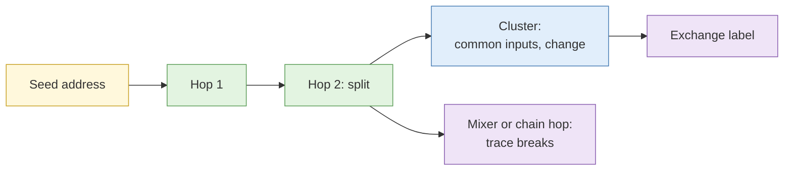

# Lab 5.6 Blockchain tracing and address clustering

| Duration | Type | Running case | Assessed |
| --- | --- | --- | --- |
| 30 minutes | Individual | Yes: traces the scenario actor's payment address | No |

## Aim

Trace a transaction chain from a seeded address, apply clustering heuristics, identify where funds reach an attributable service, and document where a mixer or chain hop breaks the trace.

## Outcome

A **transaction trace** with attribution points and a clear statement of where tracing confidence ends.

## The analogy: following the money through cash-out points

A scam payment goes from the victim to a first account, then splits across several accounts, then reaches a money changer. The changer is where a name might exist. Between the start and the changer is a path to follow.

## What you need to do

- [ ] Start from the seeded address in the scenario
- [ ] Follow outgoing transactions and record each hop
- [ ] Apply the two clustering heuristics and state confidence
- [ ] Identify the first attributable service
- [ ] Mark where a mixer or chain hop breaks the trace
- [ ] Write the trace statement

**Deliverable:** `trace.md`.

## What the instructor sets up beforehand

- A trace on a **testnet or a seeded public case** with a planted exchange label, a mixer step and a chain hop
- Block explorer access and any licensed tracing tool

## Before you start

- Read [Cryptocurrency tracing](../sessions/s6-cryptocurrency-tracing.md).

## Rules for this lab

- Testnet or seeded data only.
- Copy addresses by paste, never by hand.

## How the lab flows

## Steps

1. **Trace (12 min):** list hops in a table: from, to, amount, time.
2. **Cluster (8 min):** apply heuristics; mark each cluster with confidence.
3. **Attribute (5 min):** note the labelled service and who could hold identity data.
4. **Break point (5 min):** explain what happens at the mixer or hop, and where confidence ends.

## Common mistakes

- Treating clustering as proof.
- Not stating where the trace ends.

## Summary

Tracing finds where money goes, not who owns it. The service point is the likely key, and a clear statement of limits is part of the result.

## Carries forward

- Capstone.
