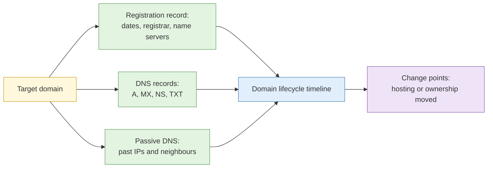

# S1 Domain and DNS intelligence

**Duration:** 15 minutes in class, about 25 minutes to read in full · **Leads into:** [Lab 4.1 Registration history and passive DNS timeline](../labs/lab-4-1-registration-and-passive-dns.md)

Every website sits on a domain name, and every domain leaves records: who registered it, when, through whom, and where it has pointed over time. These records are public by design. They are the paperwork of the internet.

## The analogy: the land title and the street directory

A domain is like a shophouse unit. The **registration record** is the land title (who owns it, when it was bought, which agent handled it). The **DNS records** are the street directory entry (what address a visitor is sent to). **Passive DNS** is an old copy of the directory from past years, showing every address the shop has used.

## WHOIS and RDAP

| Feature | WHOIS | RDAP |
| --- | --- | --- |
| What it is | Older text-based lookup | Newer structured lookup |
| Output | Free text that differs by registry | Standard machine-readable format |
| Typical fields | Registrar, creation, expiry and update dates, name servers, status codes | Same, in a consistent format |

Singapore's `.sg` domains are managed by the Singapore Network Information Centre (SGNIC); generic domains like `.com` are managed by registries and sold through registrars. Check each registry's current policy on what it shows.

### Privacy services and what is still useful

Many registrants hide their details behind a privacy service. Even then, these remain useful:

- **Creation date:** compare with the first sign of a campaign.
- **Registrar:** some registrars are favoured by particular kinds of operator.
- **Name servers:** the same unusual name server across several domains is a link.
- **Status and update dates:** transfers and changes mark moments of interest.
- **Historical WHOIS:** older records, from before privacy was enabled, sometimes show the original registrant. Treat them with caution because they may be stale or false.

## DNS record types

| Record | What it does | Why you care |
| --- | --- | --- |
| A / AAAA | Points a name to an IPv4 / IPv6 address | Where the site is hosted |
| CNAME | Alias to another name | Reveals third-party services and CDNs |
| MX | Mail servers | Which email provider handles the domain |
| TXT | Free text (SPF, verification tokens) | Service verifications, mail policy |
| NS | Name servers | Who controls the DNS |

## Passive DNS

Passive DNS databases store what DNS answers were seen over time. They let you ask:

- What IP addresses has this domain pointed to in the past?
- What other domains have pointed to this IP?

**The analogy:** the entire history of who lived at a block address. Two companies sharing the same unit in the same year may be related, or may simply have used the same virtual office.

## Subdomain discovery through passive techniques

Subdomains (`mail.example.com`, `shop.example.com`) often show forgotten or internal-facing services. Passive sources include certificate transparency logs (Lab 4.2), passive DNS, and search engines. This course uses passive discovery only.

## Registration patterns as an attribution signal

Operators often register in bulk, using the same registrar, name servers, payment pattern, naming style and registration times. Such patterns link domains. They also have innocent explanations: many people use the same registrar. Treat a pattern as a lead.

## Common mistakes

- Treating a shared registrar as a link.
- Treating old WHOIS data as current.
- Forgetting time zones when comparing registration times.

## Check your understanding

1. Which fields remain useful when a privacy service hides the registrant?
2. What does a CNAME record tell you?
3. Why is a pattern across domains a lead and not proof?

## Key points

- Registration records and DNS history are public paperwork that tells a story over time.
- Creation dates, name servers and change points are strong clues even with privacy on.
- Patterns link domains but have innocent explanations.
