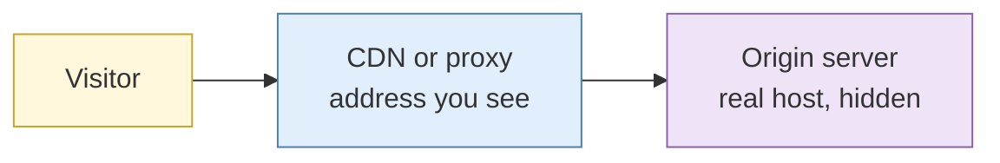
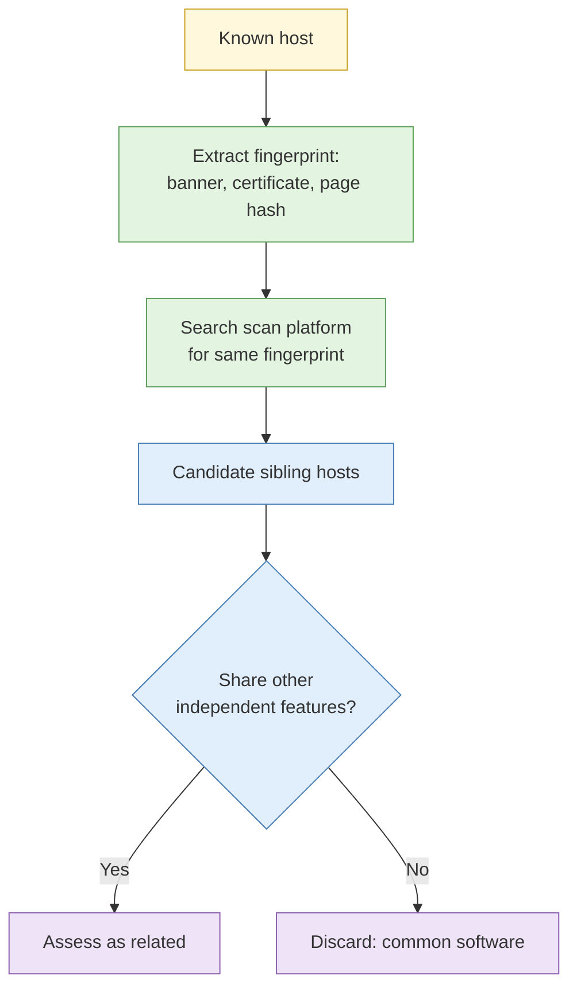

# S2 IP, hosting and network layer

**Duration:** 20 minutes in class, about 30 minutes to read in full · **Leads into:** [Lab 4.3 Network layer and scan data pivoting](../labs/lab-4-3-network-layer-and-scan-data.md) and [Lab 4.4 Origin behind a CDN](../labs/lab-4-4-origin-behind-a-cdn.md)

Domains point to IP addresses, and IP addresses belong to networks. This session explains who runs which networks, how to read scan data other people have already collected, and why a website's visible address is often not where its content really lives.

## The analogy: postal codes and building owners

An IP address is like a postal code plus unit number. The **ASN** (autonomous system number) is the building owner who manages a whole estate of postal codes. A **netblock** is a range of units they manage. Knowing the owner tells you who to ask, and a lot about the kind of tenants.

## IP allocation, ASN and netblock analysis

- **Regional registries** (APNIC for Asia-Pacific) record who holds which IP ranges.
- An **ASN** identifies an organisation running a network (an ISP, a cloud provider, a company).
- A **netblock** is a contiguous range of addresses.
- Look up an IP to find its netblock, ASN and holder; then look at what else lives in the same netblock.

## Hosting provider identification

From the ASN and netblock you can often tell:

- A major cloud provider (hosting by the hour; many unrelated tenants)
- A local hosting company (more likely a specific business relationship)
- A residential or mobile network (a person's connection, not a server)
- Hosting known for little oversight (sometimes called bulletproof hosting), which is a risk indicator but not proof of wrongdoing

## CDN and reverse proxy effects

A content delivery network (CDN) or reverse proxy sits in front of a site and presents its own addresses. This improves speed and protection, and it hides the real server.

**The analogy:** a hotel front desk. You deal with the desk; the person you want sits in a back office. Finding the back office means looking for places where the hotel accidentally printed its real address: old letters, mismatched records. Lab 4.4 shows this as an instructor demonstration on a sandbox target. It is not an exercise to run against real organisations.

## Internet-wide scan data platforms

Platforms such as **Shodan** and **Censys** continuously scan public addresses and record what answers: open services, banners, certificates and fingerprints. You are reading what they already collected, not scanning yourself.

| What you can search | What it shows |
| --- | --- |
| By IP or range | Services seen on those addresses |
| By certificate | Hosts presenting the same certificate |
| By banner or response text | Hosts running the same software or page |
| By technology | Version and product fingerprints |

Rules: use licensed accounts, follow each platform's terms, and use results as leads. Scan data can be old, and an address can change owner.

## Banner, certificate and response fingerprint pivoting

A fingerprint is a feature shared by a family of hosts: an unusual banner, a particular certificate, a distinctive page. Pivoting means searching for the same fingerprint to find sibling hosts.

Common software produces common fingerprints; the more unusual the fingerprint, the stronger the pivot.

## Legal and ethical limits

Reading scan data is passive. Running your own scans against someone else's systems is not (see Lab 1.3, item 14). This course does not scan third parties.

## Common mistakes

- Treating a shared IP as a shared owner.
- Using stale scan data.
- Pivoting on a very common banner and getting thousands of irrelevant hosts.

## Check your understanding

1. What does an ASN tell you?
2. Why does a CDN make attribution harder?
3. What makes a fingerprint a strong pivot?

## Key points

- IP, ASN and netblock identify who runs a network.
- CDNs hide origins; origin discovery is advanced and done only in sandboxes here.
- Scan platforms give leads; strength comes from unusual fingerprints and independent corroboration.
