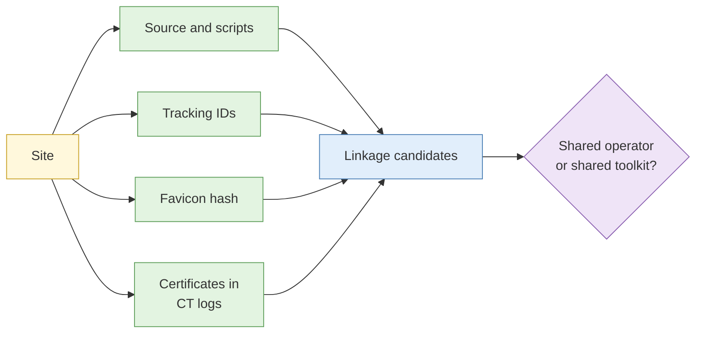

# S3 Website analysis and pivoting

**Duration:** 15 minutes in class, about 25 minutes to read in full · **Leads into:** [Lab 4.2](../labs/lab-4-2-asset-discovery.md) and [Lab 4.5 Cross-site linkage](../labs/lab-4-5-cross-site-linkage.md)

A website is more than what you see. Its source code, files and settings often show who built it, with what, and what else belongs to the same operator.

## The analogy: reading the fine print on a food packet

The front of the packet says "Original Recipe". The back lists the manufacturer, the factory code and the batch. Two different brands with the same factory code were made in the same place. A website's source code is the back of the packet.

## What to read

| Item | What it can reveal |
| --- | --- |
| Page source and comments | Developer names, tool names, leftover notes |
| JavaScript files | Services used, API endpoints, library versions |
| `robots.txt` and `sitemap.xml` | What the owner asks crawlers to ignore or lists |
| Technology fingerprints | Content management system, web server, frameworks |
| Contact and legal text | Names, addresses, registration numbers |

All of this is publicly served to every visitor. Reading it is passive collection. Do not change URLs to reach things the site does not link to.

## Tracking identifiers and analytics codes

Sites reuse analytics and advertising tags. The same identifier on two sites suggests the same account owner behind both.

| Identifier | What it suggests |
| --- | --- |
| Analytics property ID | Same analytics account |
| Advertising or tag-manager ID | Same marketing setup |
| Payment or chat widget keys | Same service account |

Caution: agencies and shared templates reuse these across clients. A shared ID is a lead, not proof of one operator.

## Favicon and asset hash pivoting

Compute a hash of the site's favicon or a distinctive image, then search scan platforms for other sites serving the same file. Template copies share assets, so use unusual files.

## Certificate transparency logs

Public logs record certificates issued for domains. Searching a domain finds certificates and the names on them, including subdomains. They are a strong passive way to discover assets (Lab 4.2).

## Shared operator or shared toolkit?

Two sites can share features because one person runs both (shared operator), or because both used the same kit or template (shared toolkit). State which you can support and why. The test: does a *unique* feature link them, not a common one?

## Common mistakes

- Treating a shared analytics ID as a shared owner.
- Pivoting on template files.
- Probing for unlinked pages.

## Key points

- Page source and assets reveal tools and links.
- Tracking IDs and asset hashes are leads, with false positives.
- Certificate transparency logs are a strong passive discovery source.
- Always test: operator or toolkit?
