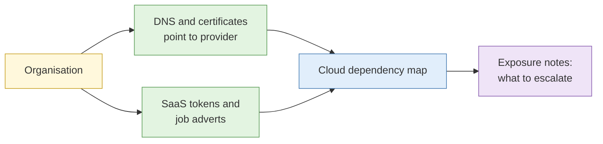

# S4 Cloud environments

**Duration:** 15 minutes in class, about 20 minutes to read in full · **Leads into:** [Lab 4.6 Cloud footprint](../labs/lab-4-6-cloud-footprint.md)

Many organisations now keep data and run services in the cloud. That adds a layer of assets with their own risks, and a new set of public clues about what an organisation uses.

## The analogy: renting storage units

An organisation can keep files in its own office (on-premises) or rent lockers in a big storage facility (cloud). The facility has thousands of tenants. If a tenant leaves a locker door open, anyone walking past can see in. The fix is usually the tenant's, not the facility's.

## Mapping cloud-hosted assets

Passive clues that point to a cloud provider:

- DNS records that point to provider-owned names
- IP addresses within a provider's published ranges
- Certificate names and CNAME records naming provider services
- Scripts and assets loaded from provider-hosted domains

Provider IP ranges are published, so you can tell which provider hosts an address.

## Storage and container exposure, handled responsibly

Cloud storage can be made public by mistake. This course covers the **concept** and the **defensive response**, not techniques to hunt for other people's storage:

- Know that misconfigured public storage is a major cause of data exposure.
- Recognise public references to storage that an organisation itself publishes (for example, a link on its own pages to a file store).
- If, in live work, you come across storage that appears to hold personal or sensitive data without protection, **stop, record the URL, do not browse or download the contents, and escalate**. Accessing it is likely beyond what you are authorised to do (CMA, Lab 1.3).
- Lab 4.6 works on a **sandbox organisation** only.

## SaaS and third-party service artefacts

An organisation's public footprint also shows which services it uses: email security records in DNS, verification tokens for collaboration tools, job adverts naming platforms. These show dependencies, and a supplier compromise can become your client's problem.

## Attribution complications from shared and ephemeral infrastructure

Cloud addresses are shared and reused. The IP that hosted an attacker yesterday may host an unrelated business today. Always tie an IP to a date, and treat a cloud IP as a weak identifier of an operator.

## Common mistakes

- Treating a cloud IP as an operator.
- Opening content in public storage "just to check".
- Ignoring SaaS dependencies.

## Key points

- Cloud assets are traceable through DNS, certificates and published provider ranges.
- Stop and escalate on suspected exposure; never browse the contents.
- Dates matter because cloud IPs change hands.
