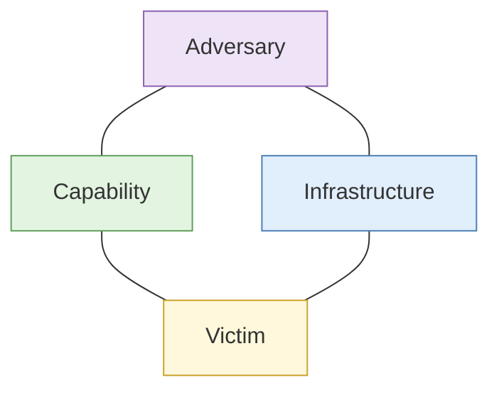

# S5 Cyber threat intelligence

**Duration:** 25 minutes in class, about 35 minutes to read in full · **Leads into:** [Lab 4.7 ATT&CK mapping and Diamond Model clustering](../labs/lab-4-7-attack-and-diamond.md)

Cyber threat intelligence (CTI) takes the infrastructure skills from this morning and uses them to describe an adversary: what they can do, how they work, what they want. It gives defenders something to act on.

## The analogy: a police profile of a pickpocket gang

Police don't list every stolen wallet. They describe the gang: where they work (stations at rush hour), how (a distraction and a quick hand), who they target (tourists), and what they leave behind (a recognisable bag). That description lets them predict the next move and place officers. CTI does this for cyber adversaries.

## Priority intelligence requirements

Just as in Day 1, CTI starts with a question. A **priority intelligence requirement** (PIR) is a question the organisation most needs answered, for example "Is a group targeting Singapore logistics firms with payment-diversion emails?" PIRs set what you collect.

## Frameworks

### MITRE ATT&CK

A public catalogue of adversary **tactics** (goals, like Initial Access) and **techniques** (methods, like Phishing). Mapping observed behaviour to ATT&CK gives a shared language.

### The Diamond Model

Every intrusion event has four corners:

Pivoting from one corner finds the next. Two events sharing several corners suggest one operator.

### The intrusion kill chain

A sequence of stages from reconnaissance to action on objectives. Useful for finding where a defence can break the chain.

## Indicators of compromise versus TTPs

| | Indicators of compromise (IOCs) | Tactics, techniques and procedures (TTPs) |
| --- | --- | --- |
| Examples | A domain, an IP, a file hash | How the actor phishes, moves, covers tracks |
| Lifespan | Short; easily changed | Longer; harder to change |
| Use | Blocking and detection | Understanding and prediction |

**The analogy:** a gang's getaway bike (IOC) versus how they work the crowd (TTP). They can swap the bike tomorrow; changing habits is harder.

## Adversary infrastructure pivoting and clustering

Take the infrastructure from Days 4 morning (domains, IPs, certificates) and group items that share features. A **cluster** is a set believed to belong to one operator or campaign. State your clustering rule and your confidence.

## Feeds, MISP and OpenCTI

- **Threat feeds** supply indicators. Quality varies widely.
- **MISP** and **OpenCTI** are platforms for storing and sharing threat information.
- Limits: feeds contain stale or wrong indicators, and a hit is not proof of compromise.

## Attack surface mapping, applied defensively

Using the same techniques on your **own** organisation, to see what an adversary sees, is one of the best defensive uses of OSINT. Lab 4.8 does this.

## Common mistakes

- Treating every feed indicator as true.
- Attributing to a named group on weak evidence.
- Confusing a shared toolkit with a shared operator.

## Check your understanding

1. Give an example of an IOC and a TTP for the same activity.
2. What are the four corners of the Diamond Model?
3. Why are TTPs more durable than IOCs?

## Key points

- CTI answers priority questions about adversaries.
- ATT&CK and the Diamond Model give shared structure.
- Cluster carefully and say how confident you are.
- Defensive attack-surface mapping applies the same skills to your own estate.
