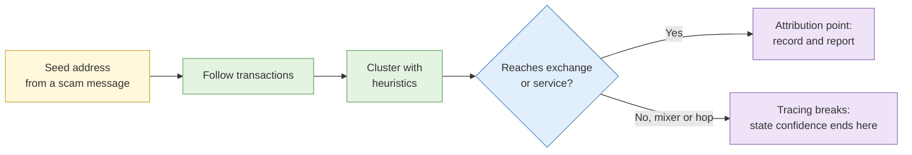

# Cryptocurrency tracing

**Duration:** 15 minutes in class, about 25 minutes to read in full · **Leads into:** [Lab 5.6 Blockchain tracing and address clustering](../labs/lab-5-6-blockchain-tracing.md)

This input comes from the old Day 5 and sits with Day 4's infrastructure work, because a payment address is another kind of selector.

## The analogy: a public ledger on the void deck notice board

Imagine every transaction in a town were written, with a timestamp, on a public notice board. Anyone can read it. But the board shows account numbers, not names. Tracing is following the account numbers across the board and finding the moment a number meets a real-world name: a shop, a bank, an exchange.

## Blockchain fundamentals for investigators

- A **blockchain** is a public, append-only ledger.
- Transactions show **addresses**, **amounts**, **times** and **links** between addresses.
- Names are not recorded. Identity comes from outside the chain.
- Bitcoin-style chains track unspent outputs; account-based chains (like Ethereum) track balances. The tracing method differs slightly.

## Address clustering and common ownership heuristics

A **heuristic** is a rule of thumb. Examples:

- **Common input ownership:** addresses used together as inputs in one transaction are likely controlled by one wallet.
- **Change address:** the leftover amount returned in a transaction often goes to a new address owned by the sender.

Heuristics are not facts. Privacy techniques can break them. State a confidence level for each cluster.

## Block explorers and tracing tools

Block explorers let you look up addresses and transactions. Commercial tracing tools add clustering and labels. The labels come from the vendor's data, so assess their quality.

## Exchange and service attribution

The point where funds reach an exchange or service is where off-chain data can identify a person: customer records held by the service. Investigators usually cannot see these records. Law enforcement or the service itself may be able to, through proper process. Reporting this point clearly is often the most useful output.

## Obstacles

| Obstacle | Effect |
| --- | --- |
| Mixers / tumblers | Pool and re-send funds, breaking the link |
| Privacy coins | Hide amounts or addresses |
| Chain hopping | Swapping assets across chains |
| Peel chains | Many small steps to hide the source |

Say plainly where tracing confidence ends.

## Linking on-chain activity to real-world selectors

Addresses show up in scam messages, ransom notes, social posts and donation pages. Capture them and treat them as selectors. Verify spelling carefully, because one wrong character gives a different address.

## Common mistakes

- Treating a heuristic as proof.
- Copying an address by hand and getting a character wrong.
- Not stating where the trace stops.

## Key points

- The ledger is public; identities are not.
- Heuristics cluster addresses, with caveats.
- The exchange point is where real-world identity may exist.
- Be explicit about where tracing confidence ends.
