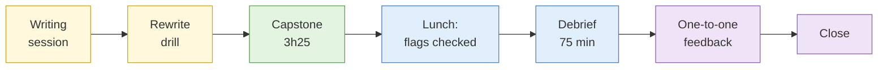

# Day 5: Analytic writing, capstone and debrief

By the end of today you will have run one full investigation under time pressure, written it up so a client can act on it, seen what a stronger version looks like, and written the plan that carries the course into your real work.

## The day at a glance

Think of today as the final practical at a driving school followed by a coffee with the examiner. In the morning you sharpen one last skill, writing. Then you drive the whole route on your own: plan, collect, link, judge, write. After lunch, the examiner replays the route and points out the junctions you missed. The day ends with a short one-to-one and a plan for what you will practise on Monday.


**Consent and legal flags for today.** The capstone is sandbox-only and passive. Stop rules apply: contact with any asset outside the sandbox, opening content marked for escalation, or copying real personal data into the report ends the capstone for that delegate. Your transfer plan must include an authorisation line: nothing from this course is to be used on a real person or organisation without a written mandate and scope.


## Learning objectives covered

| Theme | Objective |
| --- | --- |
| Analytic writing | Communicate findings with calibrated confidence and clear actions |
| Integration | Plan and run a full investigation from requirement to product |
| Evidence handling | Maintain hashes, custody and a defensible case export |
| Law and ethics | Apply all boundaries under time pressure; write an authorisation plan |

## Run sheet

| Time | Item | Min |
| --- | --- | --- |
| 08:45 | [Analytic writing session](sessions/s1-analytic-writing.md) | 15 |
| 09:00 | [Lab 4.9 Assessment rewrite drill](labs/lab-4-9-assessment-rewrite.md) | 25 |
| 09:25 | Capstone brief and catch-up case pack | 10 |
| 09:35 | [Capstone investigation and written assessment (assessed)](labs/capstone-investigation.md) | 205 |
| 13:15 | Lunch (instructors verify flags and pick debrief examples) | |
| 14:15 | [Capstone debrief](sessions/capstone-debrief.md) | 75 |
| 15:30 | Break | |
| 15:45 | [Individual feedback, transfer plan and evaluation](sessions/individual-feedback-and-transfer-plan.md) | 45 |
| 16:30 | [Course close](sessions/course-close.md) | 15 |
| 16:45 | Buffer (early finish if unused) | 45 |

The 15 minute capstone break is taken in place during the 205 minutes.

## What you take away

- Your threat assessment and case export
- The assessment template
- Your transfer plan
- Your assessed results and one-to-one feedback

## Course outcome

You leave able to run a lawful, documented, hypothesis-driven open source investigation from a client question to a written assessment, and to say how sure you are and why.
