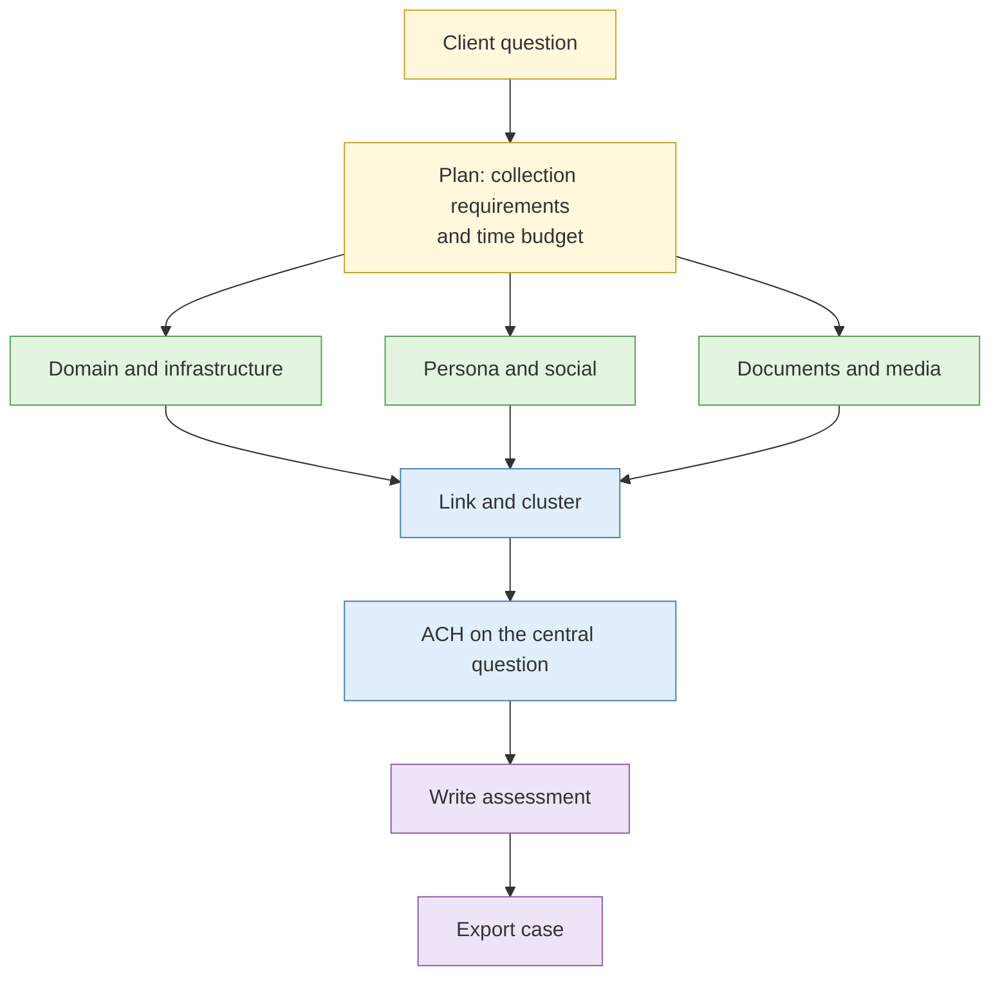

# Capstone: the full investigation (assessed)

| Duration | Type | Running case | Assessed |
| --- | --- | --- | --- |
| 205 minutes working time, plus a 15 minute break taken in place | Individual | Yes: the scenario you have followed since Day 1 | **Yes: flags and written assessment** |


**Sandbox only.** Every site, account, domain, address and document in this capstone is a fictional or instructor-controlled asset. You will not be asked to look at, and must not look at, a real person or a real organisation. Passive collection only. Do not log in, scan, test or contact anything.


## Aim

Run a complete investigation from the client's question to a written threat assessment, using the methods from all four days, under time pressure, with your own case file.

## Outcome

A **threat assessment report** and a complete **case export** (Hunchly export, Obsidian vault, hash log, custody log).

## The analogy: the final practical driving test

On the test you learn nothing new. You combine what you have practised: check mirrors, signal, read the road, handle the surprise junction, and stay calm. The examiner is also checking whether you know when to stop.

## The scenario

The client is **Kelmbrook Holdings** (fictional). Its customers have received messages from a fake hiring page and an investment scheme that both use its name. The client's question is:

> **Who is behind these activities, how are they set up, and what should Kelmbrook do first?**

You continue the case you started in Lab 1.1. If your case file is incomplete, use the **catch-up case pack** (see below).

## What you need to do

- [ ] Open your case file and re-read the requirement from Lab 1.1
- [ ] Confirm your research environment is clean (snapshot reverted, profile correct, Hunchly capturing)
- [ ] Work through the investigation in the order that suits the evidence, not the order of the days
- [ ] Capture and hash everything you rely on, with a custody log entry
- [ ] Capture the **eight flags** hidden in the scenario assets (see below)
- [ ] Run a short ACH on the central question
- [ ] Write the threat assessment using your `assessment-template.md`
- [ ] Export your case and hand in the report by the end of the working time

**Deliverables:** `threat-assessment.md` and the case export folder.

## The eight flags

A flag is a short code string planted in the scenario that proves you found a specific thing. Capture it in your case file next to the evidence that led to it. A flag with no evidence trail scores zero.

| Flag | What it proves you found | Days it draws on |
| --- | --- | --- |
| F1 | The hidden earlier version of the scam site | 2 |
| F2 | The metadata marker in the fake brochure | 2 |
| F3 | The persona's reused username on a second platform | 3 |
| F4 | The place where the staged photo was really taken | 3 |
| F5 | The registrant link that joins the two domains | 4 |
| F6 | The shared analytics ID across the sites | 4 |
| F7 | The cloud service the operation depends on | 4 |
| F8 | The attributable service point in the payment trace | 4 |

Flags are checked by the instructors over lunch against your evidence trail.

## Catch-up case pack

If you missed a lab or your case file is thin, the instructors hand you a **catch-up pack** at 09:25. It holds the missing intermediate products (for example a prepared timeline from Lab 2.4 or a cluster table from Lab 3.5). Using it is not penalised. You are scored on what you do with the evidence, not on whether you generated every earlier artefact yourself.

## Rules for this lab

- Passive, sandbox sources only. No contact, no logins, no tests.
- If you find something that looks exposed, record it and write the escalation note. Do not open it.
- No personal data copied into the report. Describe it.
- You may use all your notes, templates and tools from the week.
- You may not use another delegate's work.
- Ask an instructor if you are unsure about a legal boundary. Asking is never penalised.

## How the lab flows

## Suggested time budget

You may deviate, but a plan is expected.

| Block | Minutes |
| --- | --- |
| Plan and collection requirements | 15 |
| Collection: infrastructure, persona, documents and media | 100 |
| Link, cluster, ACH | 30 |
| Write the assessment | 45 |
| Export and custody check | 15 |

The 15 minute break is taken in place at any point. The clock keeps running.

## What the report must cover

Using your template, the assessment must address:

1. **Actor identification and confidence.** Who, or what kind of operator, and how sure.
2. **Infrastructure mapping.** Domains, hosting, cloud services, payment points.
3. **Assessed capability and intent.** What they can do and what they seem to want.
4. **Exposure to the client.** What Kelmbrook should worry about first.
5. **Collection gaps.** What you could not see.
6. **Recommended actions.** With owners.

## Scoring

| Component | Weight | What earns marks |
| --- | --- | --- |
| Flags with evidence trail | 40% | Each of F1 to F8 captured with a traceable path |
| Written assessment | 40% | Structure, calibrated confidence, alternatives, actions |
| Method and discipline | 20% | Custody, scope, legal boundaries, escalation judgement |

The pass mark is 60% overall **and** no breach of the stop rules (below). Marks are recorded as part of the course assessment. See the instructor marking guide for detail.

## Stop rules

Any of these ends the capstone for that delegate and triggers an instructor conversation:

- Contact with any asset that is not in the sandbox
- Opening content you were told to escalate and not browse
- Copying real personal data into the report

## Overrun rule

At the end of working time, stop collecting. If your report is not finished, hand in what you have with a one-line note saying what is missing. You are scored on what is on the page. Do not stay on at lunch to finish.

## Common mistakes

- Collecting widely and writing narrowly. Plan the report from the start.
- Starting to write only when the clock says 45 minutes left, then finding a gap.
- A flag with no evidence trail.
- A confident name for an actor when the evidence supports only "an operator who also runs X".
- Skipping the custody log because you are short of time.

## Summary

The capstone tests whether you can plan, collect cleanly, link carefully, say how sure you are and finish on time. Memory matters less. The written report carries half the marks.

## Carries forward

- Your report and case export are discussed in the [Capstone debrief](../sessions/capstone-debrief.md) and in your one-to-one feedback.
