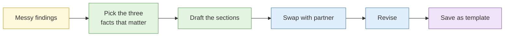

# Lab 4.9 Assessment rewrite drill

| Duration | Type | Running case | Assessed |
| --- | --- | --- | --- |
| 25 minutes | Individual, then pairs | Yes: uses findings from Days 1 to 4 | No (becomes the template for the capstone) |

## Aim

Turn a page of raw findings into a short, readable assessment using the bottom line, confidence, evidence, alternatives, gaps and actions structure.

## Outcome

A **one-page assessment** from the running case, and a reusable **template** you will use in the capstone.

## The analogy: from the shopping receipt to the monthly budget summary

A receipt lists every item. A budget summary says "You overspent on food by $120, mainly eating out. Cut two meals a week to fix it." Same facts, but one of them is useful on the way out the door.

## What you need to do

- [ ] Read the **messy findings page** from the case pack
- [ ] Mark the three facts that actually matter to the client's question
- [ ] Draft the bottom line (two sentences maximum)
- [ ] Set confidence with a reason
- [ ] List three to five evidence points, each with a source grade
- [ ] Name one alternative and one gap
- [ ] Write two or three actions with owners
- [ ] Swap with a partner and mark each other's draft using the checklist below

**Deliverable:** `assessment-draft.md` in your case folder. Save a copy as `assessment-template.md` with the headings only.

## What the instructor sets up beforehand

- A messy findings page from the running case (about two pages, chronological, with some irrelevant detail and one overclaimed sentence)
- A printed peer-check list (below)
- The client's one-line question for the scenario

## Before you start

- Read [Analytic writing](../sessions/s1-analytic-writing.md).

## Rules for this lab

- Use only facts on the findings page. Do not add new research.
- No more than 250 words in the draft.
- No dashes used as punctuation. Full sentences.

## How the lab flows

## Steps

1. **Triage (5 min):** highlight what answers the client's question. Strike what does not.
2. **Draft (10 min):** write each section in order. Bottom line last if it helps, but place it first.
3. **Peer check (5 min):** swap and tick the checklist for your partner.
4. **Revise and save (5 min):** fix the two weakest items. Save the template.

## Peer-check list

- [ ] Can I stop after the first two sentences and still know what to do?
- [ ] Is every confidence word followed by a reason?
- [ ] Is any sentence stronger than its evidence?
- [ ] Is the alternative a real one, not a straw man?
- [ ] Does each action name an owner?
- [ ] Is anything here that the client does not need?

## Worked example

> **Bottom line.** The "Kelmbrook Careers" page is very likely run by the same person who runs the investment scam site. Report both to the host and the police.
> **Confidence.** Very likely, because both share a unique analytics ID and a registrant email, and neither is explained by a common template. Source reliability is good for registry data (B) but only fair for the social post (C).
> **Alternative.** A shared web agency could explain the ID. We rank this lower because the registrant email is also shared.
> **Gap.** We have not seen who pays for the hosting.

## Common mistakes

- Copying the findings page in a shorter font.
- Listing every finding instead of the three that matter.
- Using "possibly" for everything and committing to nothing.

## If you finish early

Rewrite the bottom line for a different reader: a CEO who has thirty seconds, then a police officer who needs the legal hook.

## Summary

A good assessment is shorter and firmer than your notes, and the structure does most of the work. Save the template, because the capstone marks this skill.

## Carries forward

- `assessment-template.md` is the skeleton for the capstone report.
