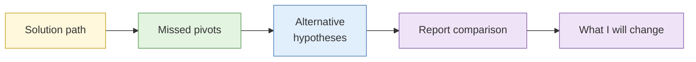

# Capstone debrief

**Duration:** 75 minutes · **Follows:** [Capstone: the full investigation](../labs/capstone-investigation.md)

## The analogy: the match replay with the coach

After a football match the team watches the replay as well as hearing the score: where the pass was missed, where the other side found a gap, what a different decision would have done. The coach points at moments and leaves people out of it.

## Aim

Walk the full solution path, show the pivots most people missed, and compare the alternative hypotheses, so every delegate leaves knowing what a stronger version of their own work looks like.

## How the 75 minutes run

| Time | Item | Min |
| --- | --- | --- |
| 14:15 | The solution path, start to end | 20 |
| 14:35 | The pivots most people missed | 15 |
| 14:50 | Alternative hypotheses and why they lose | 15 |
| 15:05 | Two anonymised delegate reports read aloud and compared | 15 |
| 15:20 | Questions and what changes in your own practice | 10 |

## 1. The solution path

The instructor walks the shortest route to all eight flags, showing for each step: the question being asked, the source used, the evidence captured and the confidence at that point. The point is to show the shape of a clean investigation, not to give a speed record.

## 2. The pivots most people missed

Before the debrief, instructors tally which flags were found by fewest delegates. They show:

- What the pivot was (for example, the favicon hash that joined two sites)
- What clue should have prompted it
- Which day's input covered it

## 3. Alternative hypotheses

The class returns to the central question and tests it again.

| Hypothesis | Support | Against |
| --- | --- | --- |
| One operator runs both | Shared analytics ID, registrant email | Different hosting providers |
| Two operators sharing an agency | Same web template | Registrant email overlap |
| A third party built both for different clients | Same developer fingerprint in source | No payment linkage |

The instructor shows how the evidence supports the first, how likely it is, and which new fact would change the call.

## 4. Two reports compared

Two anonymised reports are shown side by side. Delegates are asked, with no names attached: which would you rather receive as a client, and why? The usual answers: the shorter one, the one that ranks alternatives, the one with owners on the actions.

## 5. What changes in my practice

Each delegate writes one sentence for the transfer plan: "On Monday I will start doing ___ differently." These go into the next session.

## Debrief ground rules

- Comment on the work, not the person.
- Anonymous examples stay anonymous. Delegates may volunteer their own.
- No one is asked to explain a missed flag in front of the room.

## Key points

- A clean path is short and well recorded.
- The missed pivots follow patterns. Learn the patterns.
- Always keep the alternative on the page until the evidence kills it.
- Readers prefer a calibrated short report to a confident long one.
