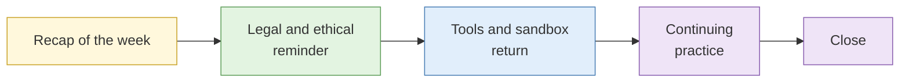

# Course close

**Duration:** 15 minutes · **Follows:** [Individual feedback and transfer plan](individual-feedback-and-transfer-plan.md)

## The analogy: handing back the keys

At the end of a flat viewing the agent hands back the keys and reminds you what you may and may not do. You walk out with the address, the rules and a number to ring if something goes wrong. That is this session.

## What is covered

### 1. Recap of the week in one page

| Day | What you can now do |
| --- | --- |
| 1 | Scope a requirement, test your own hypotheses, set up a clean research environment, work lawfully |
| 2 | Search precisely, preserve evidence, read metadata, test images and video |
| 3 | Pivot from selectors, correlate identities, geolocate, build a defensible subject profile |
| 4 | Map domains, networks, websites, cloud and cyber threat actors, trace crypto payments |
| 5 | Put it together and write it so the reader can act |

### 2. The legal and ethical reminder

Said once, plainly, at the end:

- Reachable is not authorised. Being able to see something does not give you the right to use it.
- The **Personal Data Protection Act** covers how you collect, use and keep personal data, including NRIC numbers.
- The **Computer Misuse Act** covers unauthorised access and related acts. Passive observation is different from probing.
- The **Protection from Harassment Act** covers doxxing and targeted harassment.
- Written scope and a lawful basis come before collection on any real person or organisation.
- When unsure, stop and ask your legal team.

The course materials are teaching content. They are not legal advice.

### 3. Sandbox and tools

- Sandbox environments are shut down after today. Do not try to return to them.
- Take home your own templates, scripts and notes. Do not take home any personal data from the sandbox.
- Delete or archive your research VM as your employer's policy requires.
- Tool licences issued for the course (for example Hunchly) end as stated on the licence.

### 4. Continuing practice

- Choose one authorised task in the next 30 days, as in your transfer plan.
- Reuse your assessment template and custody log on it.
- Keep a short log of what worked and what did not.
- Re-read the legal reminder before every real task, including the first.

### 5. Close

The organiser thanks delegates, collects the final items and confirms how to reach the instructors with follow-up questions.

## Course outcome

You leave with the ability to run a lawful, documented, hypothesis-driven open source investigation from a client question to a written assessment, and the habit of saying how sure you are.

## Key points

- Use these skills only inside your authority.
- Start with one small, authorised, real task.
- Templates and habits outlast any single tool.
