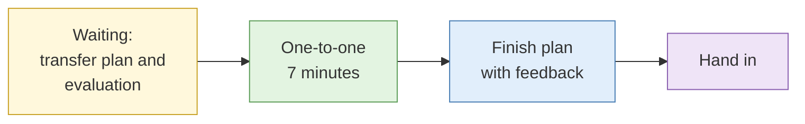

# Individual feedback, transfer plan and course evaluation

**Duration:** 45 minutes · **Follows:** [Capstone debrief](capstone-debrief.md) · **Leads into:** [Course close](course-close.md)

## The analogy: the post-service check with your mentor

After your first week on the job, a good senior colleague sits down with you for a few minutes. They say what you did well, name the one habit that will trip you up, and agree what you will practise next. Then you get back to work.

## How the 45 minutes run

Each delegate has a one-to-one slot of about seven minutes with an instructor. While you wait, you write your transfer plan and fill in the course evaluation. Slots are posted on the board at lunch.

## The one-to-one

The instructor covers, in order:

1. Your two strongest moments from the week (specific, with evidence).
2. Your single most important improvement (one only).
3. Your assessed results: Lab 2.8, Lab 3.8, Lab 4.8, the capstone.
4. Any legal or ethical judgement they want to discuss.
5. Your questions.

You may ask for your marks to be explained. You may disagree and say so. Disagreement is noted and does not change your result in the room; a formal review route is available through the course organiser.

## The transfer plan

A transfer plan is one page that turns the week into practice at your desk. Use these headings.

| Heading | What goes there |
| --- | --- |
| Authorisation | What approval I need at work before I do any of this on a real target, and who gives it |
| Environment | The research setup I will build, and by when |
| First task | One real, authorised task I will use the skills on in the next 30 days |
| Habits | Three habits I will start (for example: custody log, confidence words, snapshot revert) |
| Gaps | Two skills I need to practise more, and how |
| Legal check | Who I will ask when I am unsure about PDPA, CMA or harassment law |
| Check-in | Who will review my work and when |

The authorisation line is required. Everything in this course used sandbox material. Doing the same on a real person or organisation needs a written mandate, a scope and a lawful basis.

## Course evaluation

Fill in the evaluation form. It asks for ratings and comments on content, pace, labs, materials, instructors and venue. Comments are anonymous unless you sign. Instructors read them after the course and they change the next run.

## What to hand in

- Transfer plan (kept by you; you may share it with your line manager)
- Course evaluation (collected)
- Case export (as requested in the capstone)

## Common mistakes

- Writing a plan with no authorisation line.
- A plan with ten new habits. Three is enough.
- Skipping the evaluation because it is the end of the day.

## Key points

- Feedback is specific, one improvement at a time.
- The transfer plan starts with authorisation, not tools.
- The evaluation changes the next course.
