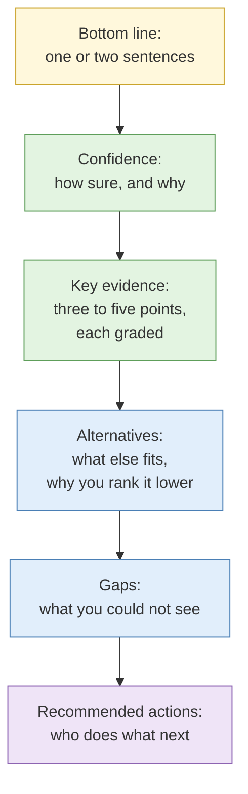

# Analytic writing: from findings to a product

**Duration:** 15 minutes in class, about 20 minutes to read in full · **Leads into:** [Lab 4.9 Assessment rewrite drill](../labs/lab-4-9-assessment-rewrite.md) and the [Capstone](../labs/capstone-investigation.md)

## The analogy: the doctor's note versus the lab printout

A lab printout lists forty numbers. A good doctor's note says: "Your blood sugar is high. I think it is early diabetes. I am fairly sure. Here is what we do next, and here is the test that would change my mind." The reader is busy and worried. They want the conclusion first, how sure you are second, and what to do third.

Your investigation notes are the printout. Your report is the doctor's note.

## Why this session is on the last day

Four days of collection skill are wasted if the reader cannot act on what you wrote. The client usually sees only the report, and the report carries your legal and reputational risk. A confident sentence you cannot back up follows you around.

## The shape of a good assessment

### 1. Bottom line first

Put the answer in the first two sentences. A reader who stops there should still know what you found and what to do. This is called BLUF (bottom line up front).

> **Weak:** "Over the course of this investigation we examined a number of sources relating to the entity."
> **Strong:** "The scam site and the fake hiring page are very likely run by the same person. We recommend reporting both to the platform and the police this week."

### 2. Say how sure you are, in words and with a reason

Use a fixed vocabulary so readers can compare your calls. This course uses:

| Word | Rough meaning |
| --- | --- |
| Almost certain | Little room for doubt |
| Very likely | Strong evidence, a small chance otherwise |
| Likely | More likely than not, real alternatives remain |
| Possible | Cannot be ruled out, thin support |
| Unlikely | Evidence points the other way |

Add the **reason** in the same sentence: "Likely, because two independent sources agree on the account, though both could trace back to one post."

Confidence in your sources is a separate thing from confidence in your conclusion. State both. Use the Admiralty grades from Day 1 for sources.

### 3. Evidence as exhibits, not a diary

Do not narrate what you did in order. Give three to five points that carry the judgement. Each point has the finding, the source grade and a pointer to the case file entry.

### 4. Alternatives and gaps

Name the strongest competing explanation and say why you rank it lower. Then list what you could not see. A report with no gaps section is a report whose author did not look for gaps.

### 5. Recommended actions with owners

"Monitor the situation" is not an action. "Client legal team to send a takedown request to the host, using the registration record at Exhibit 3" is.

## Words that quietly overclaim

| Instead of | Write |
| --- | --- |
| "proves" | "is consistent with", "strongly suggests" |
| "is the operator" | "is very likely linked to the operator" |
| "owns the address" | "controls, as far as the cluster heuristic shows" |
| "confirmed" (one source) | "reported by one source, not yet corroborated" |
| "no evidence of X" | "we did not find X in the sources checked" |

The last one matters. Absence from your search is not absence from the world.

## Writing for people, not for analysts

- One idea per sentence. Short sentences travel well.
- Define a term the first time. Your reader may not know what a netblock is.
- Put names and personal data only where the client needs them. Describe, do not copy, when you can.
- Use a table for comparisons and a short paragraph for judgement. Do not use a table for judgement.

## Common mistakes

- Starting with method instead of the answer.
- Confidence words with no reason attached.
- Treating a list of findings as an assessment.
- Burying the one thing the client must do on page three.
- Hiding doubt. Plainly stated doubt belongs in the product.

## Key points

- Answer first, confidence second, reasons third.
- Use a fixed confidence vocabulary and attach a reason.
- Name the alternative and the gaps.
- End with actions that have owners.
